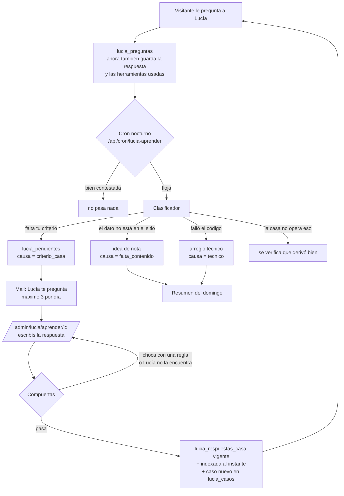

# Circuito de aprendizaje de Lucía

**Estado:** diseño para revisar · 11/09/2026 · todavía sin código.
**Qué decide Milton antes de arrancar:** la sección 13.

---

## 1. En una línea

Cada noche Lucía revisa lo que contestó mal, te pregunta a vos lo que solo vos sabés, prueba tu
respuesta contra tus reglas y recién ahí la empieza a usar. **Aprende todos los días, pero solo
dice lo que aprobaste.**

### Lo que es y lo que no

- **No es entrenar al modelo.** El modelo de OpenAI no cambia ni recuerda las charlas. Lo que crece
  es lo que Lucía tiene a mano: tus respuestas, los casos de prueba y la lista de lo que falta.
- **No redacta en tu nombre.** El sistema detecta, agrupa y te pregunta. La respuesta la escribís
  vos. Es la misma regla que ya está escrita en `data/respuestasDeLaCasa.js`.
- **No publica nada que rompa una regla tuya.** Las reglas se prueban antes de cada publicación.

---

## 2. El recorrido completo



---

## 3. Lo que ya existe y se reusa

La mitad del circuito ya está construida. Esto es lo que se aprovecha tal cual:

| Pieza | Dónde está | Para qué sirve acá |
|---|---|---|
| Preguntas guardadas | `lucia_preguntas`, `lib/luciaPreguntas.js` | La materia prima del circuito |
| Pulgares con motivo | `lucia_feedback` (`incorrect`, `outdated`, `not_understood`, `incomplete`) | Señal fuerte de respuesta floja |
| Agrupado por tema | `lib/luciaTemas.mjs` | Ordenar pendientes y el resumen |
| Respuestas de la casa en el índice | `lib/indexadorSitio.mjs` (`url = casa:<id>`) | Donde entra tu respuesta |
| Prioridad de tu palabra | `lib/luciaBusqueda.js` (`esDeLaCasa`) y el bloque `respuesta_de_la_casa` de `lib/luciaKnowledge.js` | Que Lucía la use por encima del resto |
| Herramientas usadas | `askOpenAILucia` ya devuelve `herramientas` | Saber si buscó el dato (hoy no se guarda) |
| Banco de pruebas | `tests/lucia-evaluation.json`, `scripts/evaluar-lucia*.mjs` | Donde van los casos nuevos |
| Mail saliente | nodemailer + `GMAIL_USER` / `GMAIL_APP_PASSWORD` (igual que `cron/revision-web-mail`) | El mail diario |
| Cron con `CRON_SECRET` | `vercel.json` + patrón de `cron/indexar-sitio` | El proceso nocturno |
| Panel protegido | `/admin/lucia`, `requireUser`, `getSessionUser` + `isAdminUser` | Donde contestás |

---

## 4. Cambios en la base

Mismo camino de siempre: el SQL vive en un `scripts/setup-*.mjs` y se corre desde el editor de
Supabase en tu Chrome. **Primero el SQL, después el deploy** (ver la trampa 11.2).

### 4.1 `lucia_preguntas`: guardar qué contestó

Hoy la tabla sabe **qué** se preguntó y **si** hubo respuesta, pero no **qué** contestó Lucía. Sin
eso no hay forma de juzgar si la respuesta fue floja.

```sql
alter table public.lucia_preguntas add column if not exists respuesta text
  check (respuesta is null or char_length(respuesta) <= 4000);
alter table public.lucia_preguntas add column if not exists herramientas text[] not null default '{}';
alter table public.lucia_preguntas add column if not exists casa_ids text[] not null default '{}';
alter table public.lucia_preguntas add column if not exists revisada_at timestamptz;
create index if not exists lucia_preguntas_revision_idx
  on public.lucia_preguntas (revisada_at, created_at desc) where interno = false;
```

- `respuesta`: pasa por `limpiarPregunta()` antes de guardarse, porque Lucía puede repetir un
  teléfono que le dieron.
- `casa_ids`: qué respuestas tuyas usó. Así se mide si lo que aprendió **se está usando**.
- `revisada_at`: la marca del cron, para no revisar dos veces la misma fila.

### 4.2 `lucia_respuestas_casa`: tu palabra, fuera del código

Hoy tus respuestas viven en `data/respuestasDeLaCasa.js`: cada una nueva pide commit y deploy. Con
eso el circuito no puede aprender en el día.

```sql
create table if not exists public.lucia_respuestas_casa (
  id                      text primary key check (id ~ '^[a-z0-9-]{3,60}$'),
  pregunta                text not null check (char_length(pregunta) <= 300),
  preguntas_alternativas  text[] not null default '{}',
  respuesta               text not null check (char_length(respuesta) between 20 and 1500),
  href                    text,
  tipo                    text not null default 'criterio' check (tipo in ('criterio', 'cifra')),
  vence_el                date,
  estado                  text not null default 'borrador'
                          check (estado in ('borrador', 'en_prueba', 'vigente', 'retirada')),
  resultado_prueba        jsonb,
  pendiente_id            bigint,
  creada_at               timestamptz not null default now(),
  aprobada_at             timestamptz,
  actualizada_at          timestamptz not null default now(),
  check (tipo = 'criterio' or vence_el is not null)
);
alter table public.lucia_respuestas_casa enable row level security;
```

- **El archivo no se borra.** Las 7 entradas de hoy se importan como `borrador` y el archivo queda
  como semilla. Una sola función, `respuestasDeLaCasaVigentes()`, junta archivo + tabla.
- `tipo = 'cifra'` obliga a poner vencimiento. Es la advertencia que ya está en el archivo
  ("preferí criterios antes que cifras"), convertida en regla de la base.
- `preguntas_alternativas`: otras formas de preguntar lo mismo, sacadas de las preguntas reales.
  Viajan en el texto que se indexa, así la búsqueda la encuentra mejor.

### 4.3 `lucia_pendientes`: lo que Lucía no supo

```sql
create table if not exists public.lucia_pendientes (
  id                 bigint generated always as identity primary key,
  creado_at          timestamptz not null default now(),
  causa              text not null
                     check (causa in ('criterio_casa', 'falta_contenido', 'tecnico', 'fuera_de_alcance')),
  pregunta_canonica  text not null,
  por_que            text,
  ejemplos           bigint[] not null default '{}',   -- ids de lucia_preguntas
  veces              int not null default 1,
  ultima_vez         timestamptz not null default now(),
  estado             text not null default 'nuevo'
                     check (estado in ('nuevo', 'preguntado', 'respondido', 'descartado', 'resuelto')),
  preguntado_at      timestamptz,
  respuesta_casa_id  text references public.lucia_respuestas_casa(id),
  embedding          vector(1536)
);
create index if not exists lucia_pendientes_estado_idx
  on public.lucia_pendientes (estado, causa, veces desc);
alter table public.lucia_pendientes enable row level security;
```

`embedding` usa el mismo modelo que el índice (`text-embedding-3-small`, 1536 dimensiones). Sirve
para que "¿quién ve los papeles?" y "¿tienen escribano?" se sumen al mismo pendiente en vez de
llegarte como dos preguntas.

### 4.4 `lucia_casos`: el banco de pruebas que crece solo

```sql
create table if not exists public.lucia_casos (
  id                 bigint generated always as identity primary key,
  creado_at          timestamptz not null default now(),
  question           text not null,
  category           text not null,
  origen             text not null default 'real',
  espera             jsonb not null,   -- mismo formato que tests/lucia-evaluation.json
  respuesta_casa_id  text references public.lucia_respuestas_casa(id),
  activo             boolean not null default true
);
alter table public.lucia_casos enable row level security;
```

`scripts/evaluar-lucia.mjs` lee el JSON **más** esta tabla cuando tiene credenciales. Para un caso
que se responde con tu palabra, `espera` pide el bloque `respuesta_de_la_casa` con ese id.

Las cuatro tablas llevan RLS activo y sin políticas, igual que `lucia_preguntas` y
`lucia_feedback`: solo escribe el servidor.

---

## 5. Etapa 1: registrar mejor

Hay que tocar **las dos ramas** de `app/api/lucia/route.js`, la de streaming y la normal. Las dos
llaman a `registrarPregunta`.

- Pasar `respuesta: answer.text`, `herramientas: answer.herramientas`, `casaIds: knowledge.casaIds`.
- `buildLuciaKnowledge` devuelve además `casaIds`. Ojo: tienen que salir de lo que **sobrevivió**
  al corte de 14.000 caracteres de `empaquetarContexto` (`lib/luciaContexto.mjs`), no de lo que se
  buscó. Si no, se cuenta como usada una respuesta que el modelo nunca vio. Para eso, cada item del
  bloque `respuesta_de_la_casa` lleva su `id` y `empaquetarContexto` devuelve también los ids de los
  bloques elegidos.
- `registrarPregunta` limpia la respuesta con `limpiarPregunta()` y la corta a 4000 caracteres.

**Cómo se verifica:** una pregunta en modo prueba (`?lucia=prueba`) aparece en la tabla con
`interno = true`, la respuesta completa y las herramientas.

---

## 6. Etapa 2: detectar y clasificar

**Ruta:** `app/api/cron/lucia-aprender/route.js` · `maxDuration = 60` · auth con `CRON_SECRET`.
**Horario:** `0 10 * * *` (07:00 en Argentina). Corre después del indexador (06:00) y antes del
mail de revisión web (08:00).

### 6.1 Qué filas mira

`interno = false`, `revisada_at is null`, de las últimas 72 horas. **Tope: 30 por corrida.** Lo que
no entra queda para la noche siguiente. Con el tope, el tiempo y el costo quedan acotados.

### 6.2 Señales, antes de gastar una llamada

Se descartan sin llamar al modelo las que tienen respuesta, herramientas o fuentes, y ninguna
señal en contra. Pasan al clasificador las que cumplen **al menos una** de estas:

| Señal | Cómo se ve |
|---|---|
| Falló | `respondida = false` o `error` no nulo |
| Pulgar abajo | cruce con `lucia_feedback` por `answer_id`, `rating = -1` |
| Contestó sin nada | `fuentes = 0` y `herramientas` vacío |
| Se lavó las manos | la respuesta dice que no tiene el dato o manda a WhatsApp sin dar nada (lista de frases en `lib/luciaSenales.mjs`, con tests) |
| Pregunta que no llegó a la IA | `ruta = 'guiado'` y `pareceConsulta()` de `lib/luciaAdvisor.mjs` dice que era consulta |

### 6.3 Juntar con lo que ya se sabe

Para cada fila floja:

1. Se calcula el embedding de la pregunta.
2. **¿Ya hay una respuesta tuya que la cubre?** Se consulta `buscar_sitio`. Si aparece una fila
   `casa:*` con similitud ≥ 0,55, **no falta tu criterio: Lucía no lo usó**. Va como `tecnico`, con
   el id de la respuesta ignorada. Es el error más caro y el más fácil de pasar por alto.
3. **¿Ya hay un pendiente abierto parecido?** Similitud ≥ 0,80 contra `lucia_pendientes.embedding`
   → suma `veces`, agrega el ejemplo y actualiza `ultima_vez`.
4. Si no, pasa al clasificador.

Los dos umbrales son de arranque y se ajustan mirando los primeros quince días.

### 6.4 El clasificador

Una sola llamada para todo el lote. Salida en JSON con esquema estricto:

```json
[{
  "pregunta_id": 123,
  "causa": "criterio_casa | falta_contenido | tecnico | fuera_de_alcance | bien",
  "pregunta_canonica": "¿Quién revisa los papeles en una compra?",
  "por_que": "Pregunta por el proceso de la casa; no hay página ni herramienta que lo diga."
}]
```

Lo que recibe: la pregunta, la respuesta de Lucía, las herramientas usadas, el motivo del pulgar si
hay uno, las reglas de la casa (sección 10) y estas definiciones:

- **`criterio_casa`**: solo lo puede contestar la casa (procesos, políticas, criterio comercial).
- **`falta_contenido`**: es un dato público que el sitio no tiene (servicios de un barrio,
  trámites municipales). **No te llega por mail.** Se acumula como idea de nota, y cada nota que se
  escribe responde la pregunta y además trae tráfico.
- **`tecnico`**: el dato existía y no se usó, o hubo un error.
- **`fuera_de_alcance`**: algo que la casa no opera (temporario, turístico). Se revisa que Lucía
  haya dicho que no se opera. Si ofreció el servicio, pasa a `tecnico`.
- **`bien`**: la señal fue falsa. Se marca revisada y listo.

El clasificador **no escribe respuestas**, solo diagnostica.

---

## 7. Etapa 3: preguntarte

**Cuándo:** en la misma corrida, si hay pendientes `criterio_casa` en estado `nuevo`.
**Regla de oro:** si no hay nada que preguntar, **no sale mail**. Nada de mails vacíos.

**Contenido:** hasta 3 pendientes, ordenados por `veces` y después por `ultima_vez`. Cada uno trae:

```
Me preguntaron 4 veces esta semana:
  "¿Quién revisa los papeles de la compra?"

Una de las formas en que lo escribieron:
  "y los papeles quien los ve, ustedes o un escribano"

Lo que contesté:
  "Te recomiendo consultarlo directamente con el equipo por WhatsApp…"

→ Responder (2 minutos): catalanpropiedades.com.ar/admin/lucia/aprender/17
→ No es para mí: descartar
```

Asunto: `[Lucía] 3 preguntas que no supe responder`. Remitente: el mismo transporte de
`revision-web-mail`. El pendiente pasa a `preguntado` y se guarda `preguntado_at`.

Si un pendiente lleva 7 días `preguntado` sin respuesta, vuelve una sola vez en el resumen del
domingo, no todos los días.

---

## 8. Etapa 4: responder y probar

### 8.1 La pantalla

**`/admin/lucia/aprender`**: la lista de pendientes por causa. **`/admin/lucia/aprender/[id]`**:
uno solo. Tiene que andar bien **desde el celular**, porque el link llega por mail.

En la pantalla de un pendiente:

- La pregunta canónica y todas las formas reales en que la escribieron.
- Lo que contestó Lucía cada vez.
- Un campo para tu respuesta, uno opcional para el link ("para ampliar") y el selector
  **criterio / cifra**. Si elegís cifra, pide fecha de vencimiento (se propone a 90 días).
- Tres botones: **Probar y publicar**, **Guardar borrador**, **Descartar**.

### 8.2 Las compuertas

Al tocar **Probar y publicar**, la respuesta queda `en_prueba` y pasa por cuatro controles. Los
dos primeros son instantáneos. Los otros dos corren en segundo plano (`after()`) porque llaman al
modelo, y la pantalla se actualiza sola.

| # | Control | Si falla |
|---|---|---|
| 1 | **Forma:** largo razonable, sin mails ni teléfonos, y si tiene números (`USD`, `$`, `%`, cifras) exige `tipo = cifra` con vencimiento | No se guarda; te dice qué corregir |
| 2 | **Lucía la encuentra:** se indexa como `casa:<id>` y se consulta `buscar_sitio` con la pregunta canónica y cada forma real. Tiene que salir primera entre las de la casa, arriba del umbral | Se ofrece sumar esas formas a `preguntas_alternativas` y se reintenta |
| 3 | **No choca con tus reglas ni con otra respuesta tuya:** un juez recibe tu respuesta, las reglas de la casa y tus respuestas vigentes más parecidas | Queda `borrador` con la explicación ("dice X, pero la regla 2 dice Y") |
| 4 | **Lucía la usa bien:** se corre `askOpenAILucia` con una pregunta real y el juez compara: ¿transmite tu respuesta sin contradecirla ni agregar cifras? | Queda `borrador` y te muestra lo que contestó |

Si pasan las cuatro:

- `estado = vigente` y `aprobada_at = now()`.
- El pendiente pasa a `respondido`.
- Se crea el caso en `lucia_casos`, con la pregunta real y `espera` apuntando a tu respuesta.
- **Ves el antes y el después:** lo que contestaba Lucía y lo que contesta ahora.

Si la compuerta 2 falla, la fila indexada se borra: nada queda a medio publicar.

---

## 9. Etapa 5: publicar, medir y vencer

### 9.1 Indexación inmediata

Del bucle de respuestas de la casa en `indexarSitio` se extrae `indexarRespuestaDeLaCasa(item)`.
La usan el indexador y la compuerta 2. Tu respuesta queda activa en segundos, no a la mañana
siguiente.

### 9.2 Vencimientos

El cron nocturno busca las respuestas `vigente` con `vence_el` en los próximos 7 días. Vuelven como
pendiente `criterio_casa` con el texto "¿esto sigue valiendo?". Si vence sin respuesta, **pasa a
`retirada` y sale del índice**. Una cifra vieja dicha con tu firma es peor que no decir nada.

### 9.3 Resumen del domingo

Cron semanal `0 12 * * 0` (09:00 del domingo en Argentina). Un solo mail con:

- Preguntas reales de la semana y porcentaje de flojas. **Este es el número que tiene que bajar.**
- Qué aprendió: respuestas nuevas y cuántas veces se usó cada una (`casa_ids`).
- Pendientes sin contestar hace más de 7 días.
- Ideas de nota (`falta_contenido`), ordenadas por cuántas veces se preguntó.
- Arreglos técnicos (`tecnico`), con ejemplos.

### 9.4 En el panel

`/admin/lucia` suma arriba tres números: **flojas esta semana**, **respuestas vigentes** y
**pendientes abiertos**.

---

## 10. Reglas de la casa

Archivo nuevo: **`data/reglasDeLaCasa.js`**. Es corto y lo mantenés vos. Lo usan el prompt, el
clasificador y el juez de las compuertas. Cada regla tiene al menos un caso de prueba en el banco.

Borrador para que corrijas. La columna **origen** separa lo que ya dijiste de lo que propongo yo:

| # | Regla | Origen |
|---|---|---|
| 1 | La casa opera **venta y alquiler permanente**. Nada de temporario ni turístico. Que el sitio hable de un tema no significa que lo vendamos | Dicho por vos (02/09) |
| 2 | **Nunca inventar datos:** ni precios, ni avances, ni disponibilidad. Lo que no está confirmado no se dice | Dicho por vos |
| 3 | **Contestar lo justo** y ofrecer ampliar en una línea | Dicho por vos |
| 4 | No comparar con otras inmobiliarias ni hablar de ellas | Tu criterio para el sitio; **confirmar si vale para Lucía** |
| 5 | No pronosticar el dólar ni los precios. Se describe cómo se movió el mercado; la decisión es de cada persona | **Propuesta**; hoy está en el contexto de `luciaKnowledge.js` |
| 6 | Lo legal se orienta y se deriva al equipo; no se da como asesoramiento cerrado | **Propuesta** |
| 7 | Si una propiedad publicada está por encima del modelo del m², ¿se dice? | **Decisión tuya** (sección 13) |

---

## 11. Trampas que ya conocemos

1. **El indexador borra lo que no le pasan.** `indexarSitio` borra toda fila `casa:*` que no esté en
   la lista que recibe. Hoy la llaman `cron/indexar-sitio` y `admin/indexar-sitio`, las dos con
   `respuestasIndexables()` del archivo. **Si una sola sigue leyendo solo el archivo, a la mañana
   siguiente borra del índice todo lo que respondiste desde el panel.** Las dos tienen que usar
   `respuestasDeLaCasaVigentes()`, y conviene un test que lo verifique.
2. **Primero el SQL, después el deploy.** `registrarPregunta` nunca lanza. Si sale el código que
   manda `respuesta` y la columna no existe, PostgREST rechaza el insert y **las preguntas dejan de
   guardarse en silencio**. Ya pasó con `interno`.
3. **Las dos ramas de `/api/lucia`.** Streaming y normal registran por separado. Cambiar una sola
   deja la mitad de las preguntas sin respuesta guardada.
4. **Nada de `select=*`.** Campos listados uno por uno, como en `lib/luciaPanel.js`. Sobre todo
   ahora que `lucia_preguntas` guarda la respuesta completa.
5. **El banco de pruebas no corre en el CI.** `.github/workflows/ci.yml` solo hace lint y build, y
   el nivel 2 del banco cuesta plata. Por eso las compuertas corren en producción, dentro de la
   aprobación. El banco completo sigue siendo la red de fondo y se corre a mano.
6. **60 segundos por función (plan Hobby).** El cron tiene tope de 30 filas y las compuertas 3 y 4
   corren en `after()`. Nada espera al modelo con el visitante adelante.
7. **Más material, errores nuevos.** Lo aprendido con temporario: cada respuesta nueva puede hacer
   que Lucía ofrezca algo que no existe. Por eso existen la compuerta 3 y la regla 1.

---

## 12. Orden de implementación

Cada fase se puede usar sola y deja algo verificable.

| Fase | Qué incluye | Cómo se sabe que anda |
|---|---|---|
| **0 · Registrar** | SQL 4.1 · las dos ramas de `/api/lucia` · `casaIds` en `buildLuciaKnowledge` | Una prueba con `?lucia=prueba` guarda respuesta y herramientas |
| **1 · Tu palabra en la base** | SQL 4.2 · `respuestasDeLaCasaVigentes()` · las dos rutas del indexador · importar los 7 huecos · `/admin/lucia/aprender/[id]` con compuertas 1 y 2 | Respondés un hueco desde el celular y Lucía lo usa en el momento. Al día siguiente sigue en el índice (trampa 1) |
| **2 · Detectar y preguntar** | SQL 4.3 · `lib/luciaSenales.mjs` con tests · cron `lucia-aprender` · clasificador · mail diario | Con las preguntas reales que ya hay, llega el primer mail con pendientes reales |
| **3 · Proteger y medir** | `data/reglasDeLaCasa.js` · compuertas 3 y 4 · SQL 4.4 · casos al banco · vencimientos · resumen del domingo · números en el panel | Una respuesta que ofrece temporario queda frenada con la explicación |

**Arranque en frío:** la primera corrida de la fase 2 revisa todo el histórico de `lucia_preguntas`
(sin el límite de 72 horas) y los 7 huecos entran como pendientes `criterio_casa`. No hace falta
esperar a que llegue gente nueva para ver el circuito andando.

---

## 13. Lo que tenés que decidir

1. **Canal:** mail (ya funciona) o WhatsApp más adelante. El diseño no cambia, solo el aviso.
2. **Tope y horario:** ¿3 preguntas por día a las 07:00 te sirve?
3. **Reglas de la casa:** corregir la tabla de la sección 10, sobre todo la 4, la 5, la 6 y la 7.
4. **Vencimiento por defecto de las cifras:** propuesta de 90 días.
5. **Arreglos técnicos:** solo en el resumen del domingo, o que además se abra un issue en GitHub
   (necesita un token).
6. **Quién más responde:** si Carolina puede contestar los pendientes legales desde su usuario, o
   todo pasa por vos.

---

## 14. Lo que este circuito no resuelve

- **Que le escriba más gente.** Con el uso de hoy el mail va a llegar casi vacío. El circuito rinde
  cuando Lucía esté donde hay preguntas: dentro del tasador, en WhatsApp. Es otro trabajo.
- **Criterio propio.** Lucía dice lo que vos escribiste, con sus palabras. Que opine por su cuenta
  es la decisión 7 de la sección 10, no algo que aparezca solo.
- **Errores en lo que se toma por bueno.** Una respuesta sin señales en contra (sin pulgar, con
  fuentes) no se revisa. Para eso sigue estando la lectura de `/admin/lucia`.
